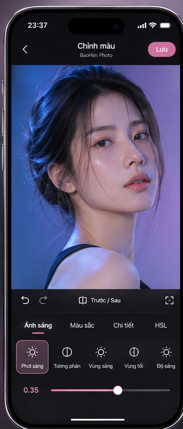
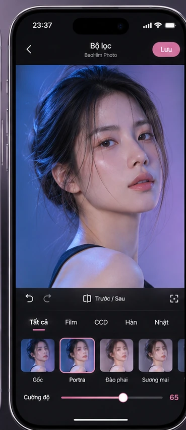
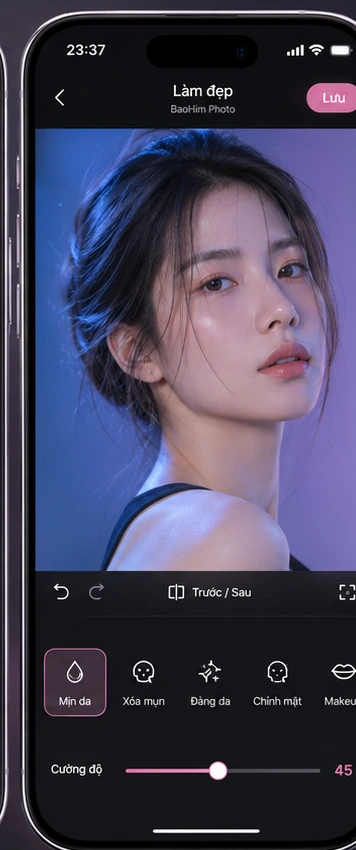
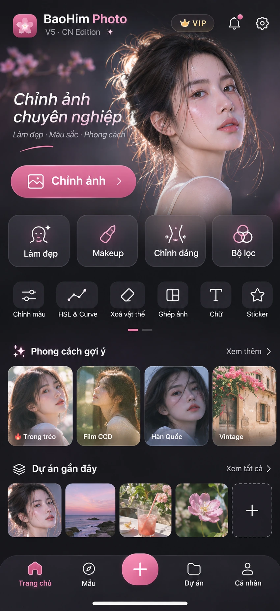
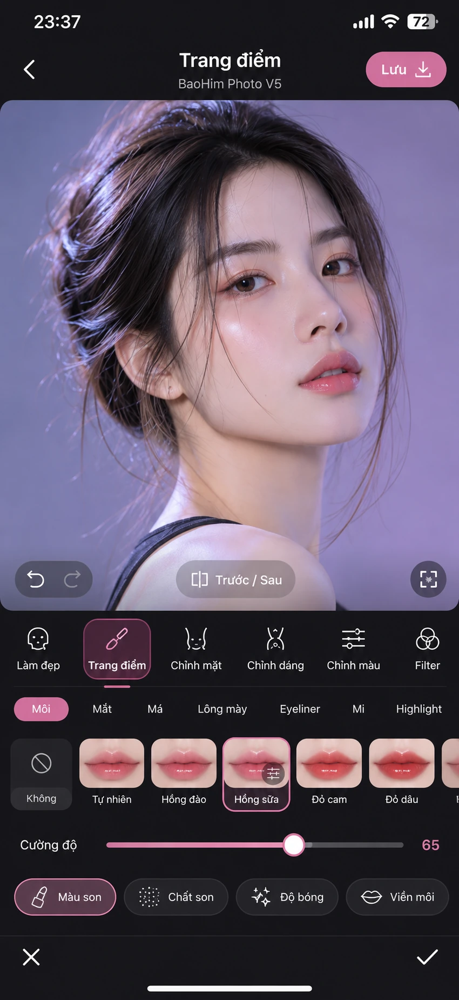
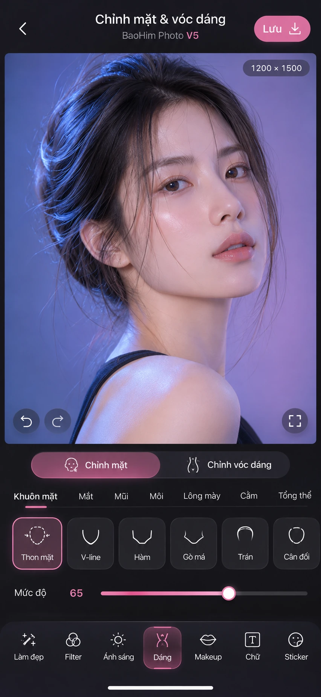
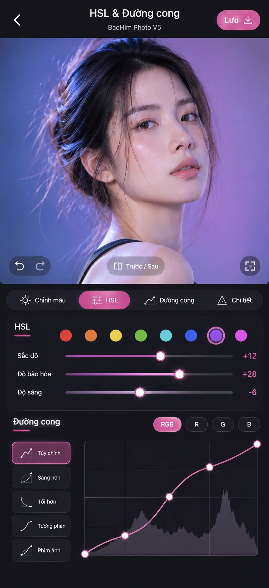

# BaoHim Photo V5 · Bộ 7 ảnh tham chiếu đã duyệt

Đây là **ảnh concept giao diện V5 · CN Edition được chủ dự án duyệt**, đưa lên GitHub để Antigravity trực tiếp đối chiếu. File WebP được nén chất lượng cao từ PNG gốc, giữ nguyên kích thước/bố cục concept. **Ba ảnh 01–03 được cắt từ ảnh tổng hợp**, do đó độ phân giải thấp hơn bốn ảnh 04–07.

> **Không dùng các ảnh này làm giao diện tĩnh trong app**. Phải dựng DOM/CSS, gắn PremiumFacade và engine V4 hiện hành. VIP, số liệu ví dụ, ảnh mẫu, icon/ảnh trang trí trong concept không có nghĩa phải triển khai dịch vụ VIP, AI hay chức năng giả.

| STT | Trạng thái UI | Ảnh tham chiếu |
| --- | --- | --- |
| 01 | Chỉnh màu | [Xem ảnh](./01_Chinh_mau.webp) |
| 02 | Bộ lọc | [Xem ảnh](./02_Bo_loc.webp) |
| 03 | Làm đẹp | [Xem ảnh](./03_Lam_dep.webp) |
| 04 | Trang chủ | [Xem ảnh](./04_Trang_chu.webp) |
| 05 | Trang điểm | [Xem ảnh](./05_Trang_diem.webp) |
| 06 | Chỉnh mặt & vóc dáng | [Xem ảnh](./06_Chinh_mat_voc_dang.webp) |
| 07 | HSL & Đường cong | [Xem ảnh](./07_HSL_Duong_cong.webp) |

## Cách đọc ảnh

- **Ảnh 04 (Trang chủ)** là nền tảng cho Phase 3 / Đợt 1: hero, CTA mở ảnh, truy cập nhanh, danh sách dự án thực, footer.
- **Ảnh 01, 02, 03** minh họa cùng một editor shell cho Color / Filter / Beauty: ảnh lớn, nền tối, một dock thấp, control tối giản.
- **Ảnh 05 (Makeup)** cho preset/brush/color chỉnh theo vùng, không phải AI nhận diện tự động.
- **Ảnh 06 (Face/Body)** cho các nhóm công cụ chỉnh khuôn mặt/vóc dáng, gắn engine Liquify hiện có.
- **Ảnh 07 (HSL/Curve)** là concept của trang nâng cao; không mặc định mở graph làm che ảnh, hãy dùng expanded panel khi người dùng yêu cầu.

## 01 · Chỉnh màu

## 02 · Bộ lọc

## 03 · Làm đẹp

## 04 · Trang chủ

## 05 · Trang điểm

## 06 · Chỉnh mặt & vóc dáng

## 07 · HSL & Đường cong

## Quy tắc triển khai

Đọc [DESIGN_SPEC.md](../DESIGN_SPEC.md) và [PHASE_3_BATCH_1.md](../PHASE_3_BATCH_1.md). Các concept có tính minh họa, không phải bản thiết kế có thông số pixel chuẩn tuyệt đối. Phải tối ưu theo kích thước viewport thật, safe-area, chất lượng ảnh 100% ở chế độ Fit và bảo toàn zoom/pan ở Manual. Không thay engine V4 bằng screenshot hay bản demo.
